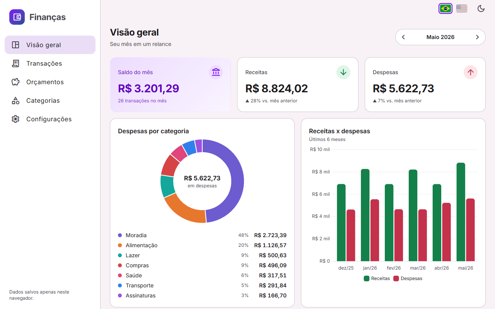

# Finanças · Personal finance tracker

🇧🇷 [Leia em português](README.md) (full documentation)

A personal finance app built with **Angular 20**, **Angular Material**, **Signals** and **Chart.js**. Record income and expenses, organize them in categories with colors and icons, set monthly budgets per category and follow the month on a dashboard with balance, budget alerts and charts. Data is kept in the browser's `localStorage`, behind a repository abstraction that can be swapped for an API without touching the screens. The first visit seeds demo data so you can explore right away.

**Demo:** https://brunoicosta.github.io/angular-finance-tracker/



## Features

- Month overview with a month navigator: balance, income, expenses, comparison with the previous month and the latest transactions.
- Transactions CRUD in a Material dialog with a typed reactive form and validation, plus undo after deleting.
- Transactions table with text search (ignores accents), type and category filters, sorting, pagination and totals.
- Categories with colors and icons; monthly budgets per category with progress bars, a warning at 80% and over-budget alerts.
- Charts: expenses by category (doughnut) and income vs expenses over the last 6 months (bars), loaded with `@defer`.
- CSV export and import (Portuguese or English format), demo data, "clear data" and "restore demo" actions.
- **Portuguese (default) and English**, switched live with the flag buttons in the header; amounts are always BRL, formatted for the active language.
- Light/dark theme, responsive layout and accessibility work (skip link, landmarks, ARIA labels, visible focus).

## Stack

Angular 20.3 (standalone, zoneless, Signals, new control flow) · Angular Material/CDK 20.2 (Material 3) · @jsverse/transloco 8.2 · Chart.js 4.5 + ng2-charts 9 · TypeScript 5.9 (strict) · Karma + Jasmine · ESLint (angular-eslint) + Prettier · GitHub Actions + GitHub Pages.

## Architecture highlights

- **Lazy everything.** `app.routes.ts` only holds the shell and one `loadChildren` per feature (`dashboard`, `transactions`, `budgets`, `categories`, `settings`), and each feature loads its page with `loadComponent`. Chart.js is registered in the dashboard route providers, so it ships with that chunk.
- **Signals store.** `FinanceStore` keeps one `signal<FinanceData>`. Everything else is `computed`, and an `effect` persists every change through an async `FinanceRepository` (localStorage today, HTTP tomorrow).
- **Money in cents, dates as `YYYY-MM-DD`** to avoid floating point and time zone bugs.
- **Pure, tested domain logic**: month summaries, budget progress, table queries and CSV parsing.
- **i18n with lazy Transloco scopes**: one translation scope per feature, loaded with its route. There are locale-aware pipes (`brl`, `localDate`, `localPercent`), translated route titles and a translated paginator. See the "Internacionalização" section of the Portuguese README for details and for how to add a language.

## Running locally

```bash
npm install
npm start          # http://localhost:4200
npm run test:ci    # unit tests in Chrome Headless
npm run lint
npm run build
```

## Author

**Bruno Vinicius Isaac Costa** · https://github.com/BrunoICosta · [MIT license](LICENSE)
