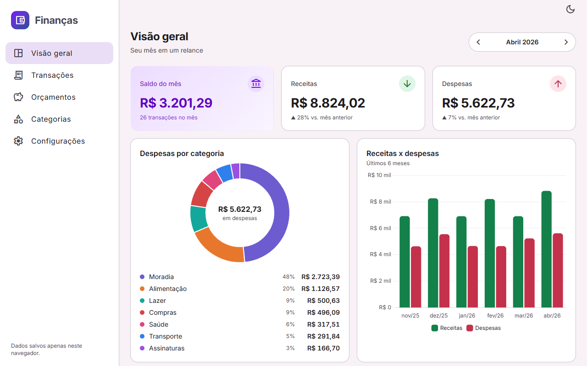

# Finanças · Controle financeiro pessoal

Aplicação de finanças pessoais feita em **Angular 20** com **Angular Material**, **Signals** e **Chart.js**. Registre receitas e despesas, organize tudo em categorias com cores e ícones, defina orçamentos mensais por categoria e acompanhe o mês em um painel com saldo, alertas de orçamento e gráficos. Os dados ficam no `localStorage` do navegador, atrás de uma camada de repositório que pode ser trocada por uma API sem mexer nas telas. Na primeira visita, o app gera dados de demonstração para você explorar.

**Demo:** https://brunoicosta.github.io/angular-finance-tracker/



## Funcionalidades

- **Visão geral do mês** com navegação entre meses: saldo, receitas e despesas, comparação com o mês anterior e últimas transações.
- **Transações (CRUD)** em um diálogo do Material com formulário reativo tipado e validação: descrição, valor, data (`dd/mm/aaaa`), tipo receita/despesa, categoria filtrada pelo tipo e observações. Exclusão com confirmação e opção de desfazer.
- **Tabela de transações** com busca por texto (ignora acentos; procura em descrição, observações e categoria), filtros por tipo e categoria, ordenação por coluna, paginação e totais do resultado. Pode mostrar só o mês selecionado ou todo o período.
- **Categorias** de receita e despesa com cor e ícone, com validação de nome duplicado. Uma categoria em uso não pode ser excluída nem mudar de tipo.
- **Orçamentos mensais** por categoria, com barra de progresso, aviso a partir de 80% e alerta quando passa do limite (também no painel). O diálogo mostra a média de gasto dos últimos meses como referência.
- **Gráficos**: despesas por categoria (rosca, com legenda acessível) e receitas x despesas nos últimos 6 meses (barras). Os dois acompanham o tema claro/escuro e carregam sob demanda com `@defer`.
- **CSV**: exporta todas as transações (`;`, vírgula decimal, UTF-8 com BOM, abre direto no Excel) e importa arquivos próprios ou de outras ferramentas (`;` ou `,`, datas ISO ou brasileiras, valores negativos como despesa, cabeçalhos em português ou inglês). Linhas inválidas são listadas com o número da linha, e categorias desconhecidas são criadas.
- **Dados de demonstração** na primeira visita, mais as ações **Limpar dados** e **Restaurar demonstração**.
- **Formato brasileiro**: moeda BRL e datas em pt-BR via `registerLocaleData`, `LOCALE_ID` e um `DateAdapter` próprio.
- **Tema claro/escuro** (segue o sistema até você escolher), layout responsivo com menu lateral recolhível e tabela compacta no celular.
- **Acessibilidade**: link para pular ao conteúdo, landmarks, rótulos ARIA, foco visível, `aria-live` nos resultados e estados de carregando, vazio e erro.

## Stack

| Camada       | Tecnologia                                                         |
| ------------ | ------------------------------------------------------------------ |
| Framework    | Angular 20.3 (standalone, zoneless, Signals, controle de fluxo novo) |
| UI           | Angular Material / CDK 20.2 (tema Material 3)                     |
| Gráficos     | Chart.js 4.5 + ng2-charts 9                                        |
| Formulários  | Reactive Forms tipados                                             |
| Linguagem    | TypeScript 5.9 (`strict`)                                          |
| Testes       | Karma 6.4 + Jasmine 5.9 (Chrome Headless)                          |
| Qualidade    | ESLint 9 + angular-eslint 20.7, Prettier 3.8                       |
| Build/Deploy | Angular CLI 20.3 (esbuild), GitHub Actions, GitHub Pages           |

## Arquitetura e decisões

```
src/app/
├── app.component.ts · app.config.ts · app.routes.ts
├── core/                     singletons usados pelo app todo
│   ├── layout/               shell (menu, barra superior, estados de carregando/erro)
│   ├── models/               Transaction, Category, Budget, FinanceData (*.model.ts)
│   ├── domain/               cálculos puros: resumo do mês, totais, orçamentos
│   ├── state/                FinanceStore e SelectedMonthStore (signals)
│   ├── storage/              FinanceRepository (abstração) + localStorage / memória
│   ├── services/             tema e notificações
│   └── data/                 categorias padrão e gerador de dados de demonstração
├── shared/                   componentes de UI, pipes, adapters e utils sem regra de negócio
└── features/                 cada feature é um chunk lazy
    ├── dashboard/            dashboard.routes.ts · pages/ · components/ · data-access/
    ├── transactions/         transactions.routes.ts · pages/ · components/ · data-access/
    ├── budgets/              budgets.routes.ts · pages/ · components/
    ├── categories/           categories.routes.ts · pages/ · components/ · models/
    └── settings/             settings.routes.ts · pages/ · data-access/ (CSV)
```

- **Lazy loading em todas as features.** O `app.routes.ts` só tem o shell e um `loadChildren` por feature, e cada `*.routes.ts` carrega a página com `loadComponent`. Nenhum componente de feature é importado fora dela. O build gera chunks separados para cada feature (`dashboard-routes`, `dashboard-page-component`, `transactions-routes`, `transactions-page-component`, `budgets-page-component`, `categories-page-component`, `settings-page-component`) e para cada gráfico (`expenses-chart-component`, `monthly-chart-component`). O Chart.js é registrado nos `providers` da rota do dashboard, então só baixa junto com esse chunk. Os gráficos ainda passam por `@defer (on viewport)`. Os chunks são pré-carregados em segundo plano com `PreloadAllModules`.
- **Signals como estado.** O `FinanceStore` guarda um único `signal<FinanceData>`. Todo o resto (categorias por id, uso por categoria, orçamentos) é `computed`, e um `effect` persiste cada mudança. Nas telas, filtros, ordenação e paginação também são signals. A página volta para a primeira página com `linkedSignal` quando os filtros mudam, e um `computed` mantém o índice dentro do intervalo quando linhas somem.
- **Repositório assíncrono.** `FinanceRepository` é uma classe abstrata usada como token de DI, com `load/save/clear` retornando `Promise`, como faria uma API HTTP. Existem a implementação com `localStorage` (que valida a forma e a versão dos dados salvos) e uma em memória para os testes.
- **Dinheiro em centavos.** Valores são inteiros (`amountCents`) para evitar erros de ponto flutuante. A formatação usa o pipe `brl` (`formatCurrency` com `pt-BR`).
- **Datas como `YYYY-MM-DD`.** Assim não há deslocamento de fuso (`new Date('2026-04-01')` seria 31/03 no Brasil). O pipe `isoDate` converte para data local antes do `DatePipe`, e o `BrDateAdapter` faz o datepicker entender `dd/mm/aaaa`.
- **Regras puras e testáveis.** Os cálculos financeiros, a consulta da tabela (filtrar, ordenar e paginar) e o CSV são funções puras, separadas dos componentes.
- **Zoneless + OnPush.** `provideZonelessChangeDetection()` e `ChangeDetectionStrategy.OnPush` em todos os componentes, garantidos por regra do ESLint.
- **Convenções.** Arquivos com sufixo de tipo (`*.component.ts`, `*.service.ts`, `*.routes.ts`, `*.model.ts`, `*.store.ts`), configurados nos `schematics` do `angular.json`. Tudo usa `input()`, `output()`, `model()`, `inject()` e bindings no objeto `host`.

## Como rodar

Pré-requisito: Node.js 22.

```bash
npm install
npm start            # http://localhost:4200
```

Outros scripts:

```bash
npm test             # testes em modo watch (Karma)
npm run test:ci      # testes uma vez em Chrome Headless
npm run lint         # ESLint (TS + templates, inclusive regras de acessibilidade)
npm run format       # Prettier
npm run build        # build de produção em dist/
```

Para gerar o build do GitHub Pages: `npx ng build --base-href /angular-finance-tracker/`.

## CI e deploy

- `.github/workflows/ci.yml`: em push e PR para `main`, roda `npm ci`, lint, testes em Chrome Headless e build.
- `.github/workflows/deploy.yml`: em push para `main` (ou manualmente), gera o build com `--base-href`, copia `index.html` para `404.html` (para as rotas da SPA funcionarem) e publica no GitHub Pages.

## Próximos passos

- Backend real: implementar um `HttpFinanceRepository` e trocar o provider em `app.config.ts`.
- Transações recorrentes (salário, aluguel) e parcelamentos.
- Várias contas e cartões, com transferência entre contas.
- Metas de economia e projeção de saldo.
- Importação de OFX e mapeamento de colunas do CSV.
- Testes end-to-end com Playwright.

## Autor

**Bruno Vinicius Isaac Costa** · https://github.com/BrunoICosta

Licença [MIT](LICENSE).
